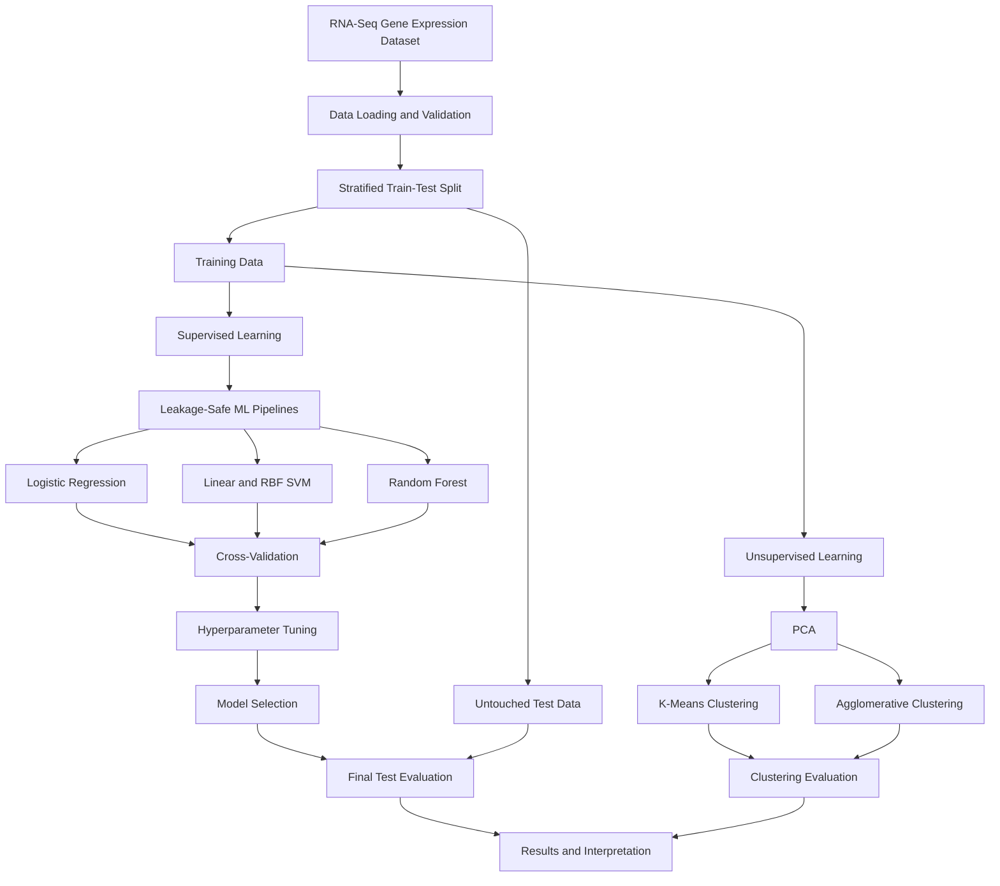

# Cancer Type Classification Using RNA-Seq Gene Expression Data

**An End-to-End Bioinformatics and Applied Machine Learning Project**

## Project Overview

This project investigates whether machine learning algorithms can accurately classify five cancer types using processed RNA-Seq gene expression data.

The study implements a complete machine learning workflow, including:

- Exploratory Data Analysis (EDA)
- Data preprocessing and feature selection
- Logistic Regression, Support Vector Machines, and Random Forest
- Cross-validation and hyperparameter optimization
- Classification performance evaluation
- Principal Component Analysis (PCA)
- K-Means and Agglomerative Clustering
- Exploratory feature importance analysis

The objective is to apply classical machine learning methods to a real-world bioinformatics dataset while emphasizing reproducibility, correct evaluation, and prevention of data leakage.

## Dataset Description

**Dataset:** TCGA-PANCAN-HiSeq-801x20531

**Source:** [UCI Machine Learning Repository](https://archive.ics.uci.edu/dataset/401/gene+expression+cancer+rna+seq)

**DOI:** https://doi.org/10.24432/C5R88H

| Property | Description |
|---|---|
| Number of samples | 801 |
| Number of gene-expression features | 20,531 |
| Number of cancer classes | 5 |
| Machine learning task | Multiclass classification |
| Dataset type | Processed RNA-Seq expression data |

The five cancer types included in this dataset are:

- BRCA — Breast Invasive Carcinoma
- COAD — Colon Adenocarcinoma
- KIRC — Kidney Renal Clear Cell Carcinoma
- LUAD — Lung Adenocarcinoma
- PRAD — Prostate Adenocarcinoma

## Machine Learning Workflow



## Methodology

### 1. Data Preparation

The dataset was loaded using Pandas, and sample identifiers were checked to ensure consistency between the feature matrix and cancer labels.

An 80/20 stratified train-test split was applied, resulting in 640 training samples and 161 test samples.

Preprocessing steps that learn from the data, including variance filtering, feature selection, and feature scaling, were implemented inside Scikit-learn pipelines to avoid data leakage during cross-validation.

### 2. Supervised Learning

The following classifiers were evaluated:

| Algorithm | Purpose |
|---|---|
| Dummy Classifier | Majority-class baseline |
| Logistic Regression | Linear classification baseline |
| Linear SVM | High-dimensional classification |
| RBF SVM | Nonlinear classification |
| Random Forest | Ensemble-based classification |

Four-fold stratified cross-validation was used to compare the models based on macro-F1, balanced accuracy, and accuracy.

### 3. Hyperparameter Optimization

GridSearchCV was used to optimize the Linear SVM pipeline.

The search included different values of the regularization parameter `C` and different numbers of selected gene-expression features.

One of the best-performing configurations used:

- `C = 0.01`
- `SelectKBest(k=300)`
- Four-fold stratified cross-validation

The tuned Linear SVM was selected as the final model.

### 4. Classification Results

The models achieved the following cross-validation macro-F1 scores on the training data:

| Model | CV Macro-F1 |
|---|---:|
| Dummy Classifier | 0.1091 |
| Logistic Regression | 0.9987 |
| Linear SVM | 1.0000 |
| RBF SVM | 0.9974 |
| Random Forest | 0.9987 |

**Final hold-out test results (161 samples):**

| Evaluation Metric | Score |
|---|---:|
| Accuracy | 1.0000 |
| Macro F1-Score | 1.0000 |
| Balanced Accuracy | 1.0000 |

The selected classifier correctly classified all 161 samples in the internal test set.

However, these results do not guarantee equivalent performance on independent datasets or in clinical settings.

### Confusion Matrix


### 5. Dimensionality Reduction Using PCA

PCA was applied to investigate the underlying structure of the high-dimensional gene-expression data.

A two-dimensional projection was created to visualize how tumor samples are distributed according to their expression profiles.


### 6. Unsupervised Learning

Two clustering algorithms were evaluated:

- K-Means Clustering
- Agglomerative Clustering with Ward linkage

The training data were standardized and projected onto 20 principal components before clustering.

The results were evaluated using Adjusted Rand Index (ARI), Normalized Mutual Information (NMI), and Silhouette Score.

| Method | ARI | NMI | Silhouette |
|---|---:|---:|---:|
| K-Means | 0.7945 | 0.8664 | 0.2837 |
| Agglomerative Clustering | 0.9853 | 0.9758 | 0.2802 |

Agglomerative Clustering showed stronger agreement with the known cancer-type labels in this experiment.

## Project Structure

```text
Cancer_RNASeq_ML_Project/
├── README.md
├── Cancer_RNASeq_Final_English.ipynb
├── requirements.txt
├── .gitignore
├── outputs/
│   ├── baseline_cv_results.csv
│   ├── final_test_metrics.csv
│   ├── test_confusion_matrix.png
│   ├── pca_train_projection.png
│   ├── training_clustering_results.csv
│   └── ...
└── TCGA-PANCAN-HiSeq-801x20531/
    ├── data.csv
    └── labels.csv
```

The dataset directory is kept locally and excluded from GitHub using `.gitignore`.

## Installation and Execution

Clone or download the repository, then obtain the original dataset from the UCI Machine Learning Repository.

Place `data.csv` and `labels.csv` inside a directory named `TCGA-PANCAN-HiSeq-801x20531` next to the notebook.

Install the required dependencies:

```bash
python -m pip install -r requirements.txt
```

Launch the notebook:

```bash
jupyter notebook Cancer_RNASeq_Final_English.ipynb
```

Run all cells sequentially to reproduce the analysis.

## Scientific Limitations

The reported results represent internal validation on a curated dataset. They should not be interpreted as evidence of clinical diagnostic performance.

Important limitations include the high dimensionality of the dataset, the possibility of dataset-specific patterns, and the lack of independent external validation.

Moreover, anonymous feature identifiers do not permit direct biological interpretation of the selected genes.

## Future Research Directions

Potential extensions of this project include:

- External validation using independent cancer genomics datasets
- Nested cross-validation and feature-selection stability analysis
- Assessment of possible batch effects
- Biological interpretation using properly annotated genes
- Investigation of additional dimensionality reduction methods
- Comparison with more advanced machine learning and deep learning approaches

## References

Fiorini, S. (2016). *Gene Expression Cancer RNA-Seq*. UCI Machine Learning Repository. https://doi.org/10.24432/C5R88H

Géron, A. (2019). *Hands-On Machine Learning with Scikit-Learn, Keras, and TensorFlow* (2nd ed.). O'Reilly Media.

---

**Disclaimer:** This project is intended for educational and research portfolio purposes only. It is not a clinical diagnostic tool.
